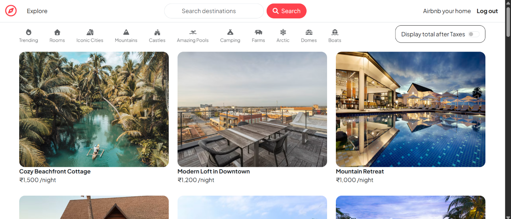
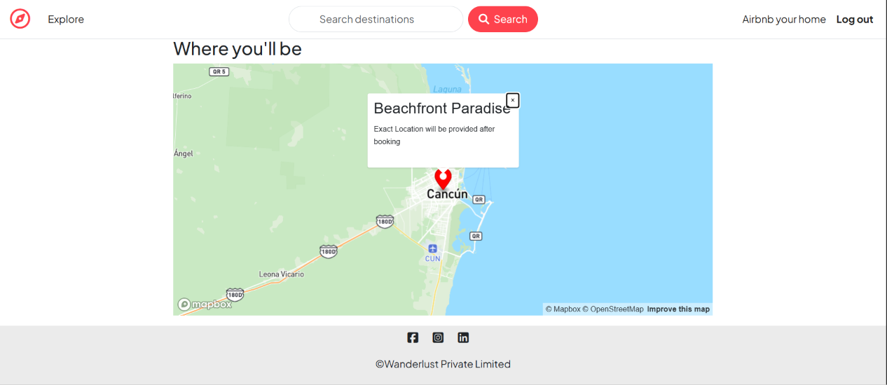
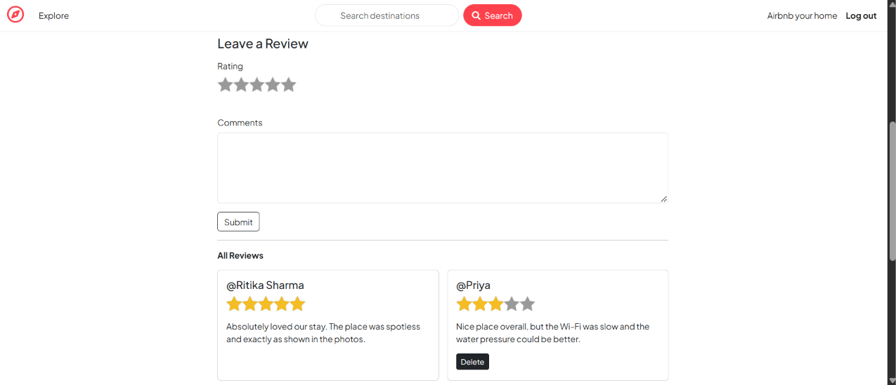
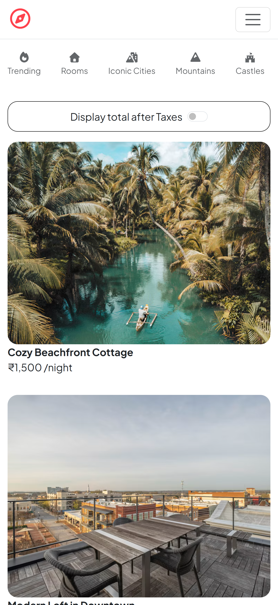

# WanderLust

A full-stack travel accommodation marketplace where users can discover, list, and review stays around the world. Built with Node.js, Express, MongoDB, and server-side rendered EJS views, with image uploads on Cloudinary and interactive maps powered by Mapbox.

**Live demo:** https://wanderlust-hx8z.onrender.com

> The app is hosted on Render's free tier. After a period of inactivity the first request can take around 50 seconds while the instance wakes up.

## Screenshots

| Home | Listing and Map |
|---|---|
|  |  |

### Reviews


### Mobile


## Features

- **Authentication:** Sign up, log in, and log out using Passport.js (local strategy), with salted and hashed passwords via `passport-local-mongoose`.
- **Persistent sessions:** Sessions are stored in MongoDB using `connect-mongo`, so users stay logged in across server restarts.
- **Authorization:** Creating, editing, and deleting listings requires login. Only the owner of a listing can edit or delete it, and only the author of a review can delete it. These checks are enforced in server-side middleware, not only in the UI.
- **Post-login redirect:** Users who hit a protected page are sent to login and then returned to the page they originally requested.
- **Listings:** Create, view, edit, and delete accommodation listings with title, description, price, location, and country.
- **Categories:** Every listing is tagged with a category (Trending, Rooms, Iconic Cities, Mountains, Castles, Amazing Pools, Camping, Farms, Arctic, Domes, Boats).
- **Search and filtering:** Filter listings by category and search by keyword across title, location, country, category, and description. User input is regex-escaped before querying.
- **Image uploads:** Listing images (PNG, JPG, JPEG) are uploaded with Multer and stored on Cloudinary.
- **Maps and geocoding:** Locations are geocoded with the Mapbox SDK and saved as GeoJSON points, then rendered on an interactive map.
- **Reviews and ratings:** Authenticated users can leave a 1-5 star rating with a comment. Each review stores its author.
- **Cascade deletion:** Deleting a listing automatically removes all of its reviews through a Mongoose post-hook.
- **Validation:** Server-side request validation with Joi (required fields, non-negative price, rating range 1-5, category restricted to the allowed list).
- **Flash messages:** Success and error feedback using `connect-flash`.
- **Centralised error handling:** Custom `ExpressError` class, an async wrapper utility, and a dedicated error page.

## Tech Stack

| Layer | Technology |
|---|---|
| Runtime | Node.js |
| Framework | Express 5 |
| Templating | EJS, ejs-mate (layouts) |
| Database | MongoDB Atlas, Mongoose |
| Authentication | Passport.js, passport-local, passport-local-mongoose |
| Sessions | express-session, connect-mongo |
| Validation | Joi |
| File upload | Multer, multer-storage-cloudinary, Cloudinary |
| Maps | Mapbox SDK |
| Deployment | Render (web service), MongoDB Atlas |

## API Routes

| Method | Route | Access | Description |
|---|---|---|---|
| GET | `/listings` | Public | List all listings |
| GET | `/listings/new` | Logged in | New listing form |
| POST | `/listings` | Logged in | Create a listing (with image upload) |
| GET | `/listings/:id` | Public | Show a listing with its reviews and map |
| GET | `/listings/:id/edit` | Owner | Edit form |
| PUT | `/listings/:id` | Owner | Update a listing |
| DELETE | `/listings/:id` | Owner | Delete a listing and its reviews |
| POST | `/listings/:id/reviews` | Logged in | Add a review |
| DELETE | `/listings/:id/reviews/:reviewId` | Review author | Delete a review |
| GET, POST | `/signup` | Public | Register |
| GET, POST | `/login` | Public | Log in |
| GET | `/logout` | Logged in | Log out |

## Project Structure

```
WanderLust/
├── app.js                 # Application entry point
├── cloudConfig.js         # Cloudinary and Multer storage configuration
├── middleware.js          # Auth, authorization, and validation middleware
├── schema.js              # Joi validation schemas
├── controllers/           # Route handlers (listing, reviews, user)
├── models/                # Mongoose models (Listing, Review, User)
├── routes/                # Express routers
├── views/                 # EJS templates (layouts, includes, listings, users)
├── public/                # Static assets (css, js, map script)
├── utils/                 # ExpressError, wrapAsync
└── init/                  # Database seed data and script
```

## Data Model

- **User:** `email`, plus username and hashed password handled by `passport-local-mongoose`.
- **Listing:** `title`, `description`, `image { url, filename }`, `price`, `location`, `country`, `category`, `geometry` (GeoJSON Point), `owner` (User), `reviews` (array of Review references).
- **Review:** `comment`, `rating` (1-5), `created_at`, `author` (User).

## Getting Started

### Prerequisites

- Node.js v24 or later
- A MongoDB Atlas cluster (or a local MongoDB instance)
- A Cloudinary account
- A Mapbox account and access token

### Installation

```bash
git clone https://github.com/priya-12340/WanderLust.git
cd WanderLust
npm install
```

### Environment Variables

Create a `.env` file in the project root:

```env
MONGO_URI=your_mongodb_connection_string
SESSION_SECRET=your_session_secret
CLOUD_NAME=your_cloudinary_cloud_name
CLOUD_API_KEY=your_cloudinary_api_key
CLOUD_API_SECRET=your_cloudinary_api_secret
MAP_TOKEN=your_mapbox_access_token
```

### Run Locally

```bash
node app.js
```

The app starts on `http://localhost:8080`.

### Seed the Database (optional)

```bash
node init/index.js
```

## Deployment

The app is deployed as a Render web service connected to this repository, with MongoDB Atlas as the database. Environment variables are configured in the Render dashboard, and Atlas Network Access allows connections from Render.

## Roadmap

- Price range filter and sorting
- Booking and availability calendar
- Wishlist and favourites
- Automated tests

## Author

**Priya Sharma**
GitHub: [priya-12340](https://github.com/priya-12340) | LinkedIn: [priya-sharma](https://linkedin.com/in/priya-sharma-4a7088303)